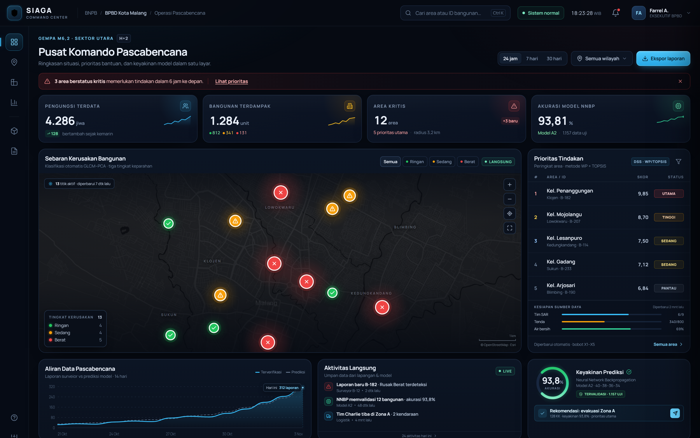

# SIAGA Command Center

**Executive dashboard pascabencana — Tugas Minggu 9, Sistem Informasi**
Farrel Faiziaulhaq Azmi · 240605110176 · Kelas G
Program Studi Teknik Informatika, UIN Maulana Malik Ibrahim Malang



**Demo langsung:** [farrelfaiziaulhaq.github.io/siaga-command-center/mockup](https://farrelfaiziaulhaq.github.io/siaga-command-center/mockup/)

**Laporan lengkap:** [PDF 15 halaman](laporan/240605110176_Farrel%20Faiziaulhaq%20Azmi_Tugas%20Minggu%209%20SI.pdf)

---

## Tentang

SIAGA Command Center adalah purwarupa high-fidelity antarmuka eksekutif BNPB/BPBD untuk situasi pascabencana. Rancangan ini menjawab satu masalah: bagaimana mengubah data lapangan yang masif dan subjektif menjadi keputusan bantuan yang cepat, terukur, dan bisa dipertanggungjawabkan.

Purwarupa dibuat sebagai HTML, CSS, dan JavaScript murni — tanpa framework, tanpa build step — agar tipografi, kontras mode gelap, hierarki, dan perilaku data langsung dapat diuji pada ukuran layar sebenarnya.

## Fitur

- **Peta tiga warna GLCM–PCA** — hijau (ringan), oranye (sedang), merah (berat); ukuran pin dan ikon berbeda agar tidak bergantung pada warna saja.
- **Daftar prioritas WP + TOPSIS** — Top 5 area, skor, status, dan kesiapan sumber daya.
- **Metrik real-time** — KPI, umpan aktivitas, timestamp relatif, status API/WebSocket, dan simulasi titik baru tanpa muat ulang.
- **Keyakinan model** — akurasi NNBP 93,81%, probabilitas per kelas, dan rekomendasi tindakan.
- **Panel detail bangunan** — lima komponen DSS, metadata survei, riwayat validasi, lampiran, serta aksi tugaskan/eskalasi.
- **Mode gelap** — tiga tingkat permukaan, kontras terukur, dan animasi yang menghormati `prefers-reduced-motion`.
- **Responsif** — 1600×1000, 1366×768, dan tata letak satu kolom untuk layar kecil.

## Menjalankan

Tidak perlu instalasi atau server.

```bash
git clone https://github.com/farrelfaiziaulhaq/siaga-command-center.git
cd siaga-command-center
start mockup/index.html      # Windows
# open mockup/index.html     # macOS
# xdg-open mockup/index.html # Linux
```

Parameter yang berguna saat presentasi:

| URL | Kegunaan |
| --- | --- |
| `?static=1` | Membekukan simulasi data langsung |
| `?detail=B-182` | Langsung membuka panel detail contoh |
| `?static=1&detail=B-182` | Kombinasi keduanya |

Kontrol: `Ctrl+K` fokus pencarian, `Esc` menutup panel, tombol **Langsung** menjeda umpan data.

## Struktur

```text
mockup/
  index.html
  assets/
    css/styles.css
    js/app.js · data.js
    fonts/Manrope-latin.woff2
    img/map-malang.png
screenshots/         enam tangkapan layar 2×
laporan/             PDF 15 halaman + sumber HTML + diagram
README.md
README.txt
```

## Catatan desain

- Latar `#060A12`, permukaan `#0C1422`, aksen sian `#38BDF8` untuk interaksi.
- Warna status: `#22C55E` (ringan), `#F59E0B` (sedang), `#EF4444` (berat). Merah tidak dipakai untuk elemen interaksi agar tidak bercampur dengan makna keparahan.
- Grid 12 kolom, gutter 24 px, radius kartu 16 px, tipografi Manrope.
- Semua teks normal memenuhi kontras WCAG AA (≥ 4,5:1).

## Data

Seluruh angka, nama kelurahan, dan kejadian pada purwarupa adalah **data simulasi** untuk menguji perilaku antarmuka. Tidak ada data pribadi atau dokumen internal BPBD. Model GLCM–PCA, NNBP, dan WP/TOPSIS tidak dilatih ulang; keluarannya direpresentasikan sesuai materi Minggu 9.

Basemap: Esri Dark Gray Canvas / OpenStreetMap, atribusi tercantum di sudut peta. Font: Manrope (SIL Open Font License).
